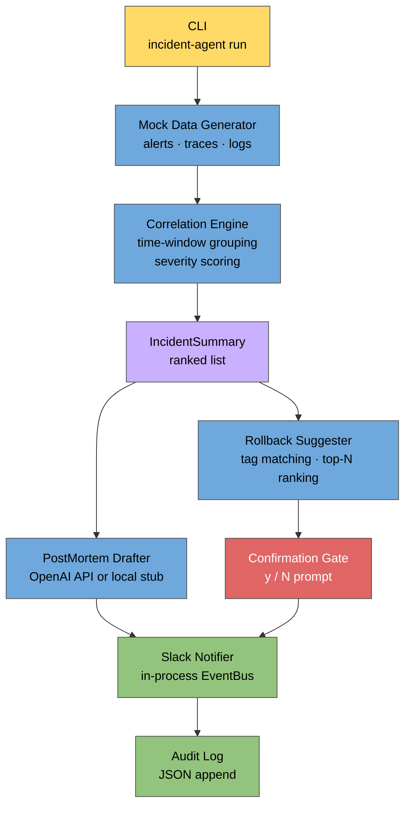

# Incident Response Agent

An AI-powered on-call assistant that ingests simulated alerts, distributed traces, and log entries; correlates them into ranked incidents; drafts structured post-mortems via an OpenAI-compatible LLM (with a zero-dependency local stub fallback); and suggests safe, human-confirmed rollback commands — all through an interactive CLI with a JSON audit trail and Slack-style in-process notifications. The goal is simple: make on-call humans faster, not obsolete.

---

## Features

- **Realistic mock data layer** — generates CPU spikes, error surges, and latency outliers entirely in-memory with no external services required; fully reproducible with a `--seed` flag
- **Time-window correlation engine** — groups signals by sliding time bucket and service tag, ranks resulting `IncidentSummary` objects by a weighted severity score
- **LLM post-mortem drafter** — calls the OpenAI API when `OPENAI_API_KEY` is present; falls back to a deterministic local stub that produces a fully-structured five-section document (Executive Summary, Timeline, Root Cause Hypothesis, Impact Estimate, Action Items) with no network calls
- **Rollback suggester** — scores a built-in library of `kubectl rollout undo`, `kubectl scale`, `feature-flags set`, Redis flush, and circuit-breaker reset commands against extracted incident tags; returns the top-N ranked by match count then risk level
- **Human confirmation gate** — always prints the suggested command and its risk level, then requires an explicit `y/N` prompt before any simulated execution; never touches a real system
- **Interactive CLI** — `Click`-based interface with four commands: `run`, `list-scenarios`, `show-audit`, and `clear-audit`; every run appends a structured entry to a local JSON audit log
- **Slack-style in-process notifications** — an `EventBus` + `SlackChannel` mock posts correlation summaries, post-mortem drafts, and rollback decisions to a named channel with optional console echo
- **TOML config file** — `agent.toml` lets you tune correlation thresholds, choose the LLM model, add custom rollback commands, and configure the audit log path
- **Comprehensive test suite** — pytest tests covering the mock data layer, correlator, post-mortem drafter, rollback suggester, notifications, CLI, and a full end-to-end integration test with ≥80% coverage target

---

## Architecture



---

## Installation

### Requirements

- Python ≥ 3.10
- No mandatory external dependencies beyond `click` (all incident data is generated in-memory)

### From source

```bash
git clone https://github.com/example/incident-agent.git
cd incident-agent

# Basic install (CLI + core pipeline)
pip install -e .

# With real LLM support
pip install -e ".[llm]"

# Development (adds pytest + pytest-cov)
pip install -e ".[dev]"
```

The `incident-agent` console-script entry point is registered by `pyproject.toml` and will be available on your `PATH` after installation.

---

## Usage

### List available scenario types

```bash
incident-agent list-scenarios
```

Output:

```
Available scenario types:

  cpu_spike         Sudden CPU saturation across services
  error_surge       Elevated HTTP 5xx error rate
  latency_outlier   P99 latency outliers
  mixed             Multi-signal: CPU, errors, and latency simultaneously
```

### Run a full incident pipeline

```bash
# CPU spike, reproducible seed, force local mock LLM, skip notifications
incident-agent run --scenario cpu_spike --seed 42 --force-mock --no-notify

# Error surge — approve the rollback interactively
incident-agent run --scenario error_surge --seed 7 --force-mock

# Mixed incident, custom services, wider correlation window
incident-agent run \
  --scenario mixed \
  --services api-gateway,payment-service \
  --window 10 \
  --seed 99 \
  --force-mock \
  --no-notify

# Skip post-mortem and rollback, just see the correlation report
incident-agent run --scenario latency_outlier --seed 5 --no-postmortem --no-rollback --no-notify
```

When you reach the rollback prompt the agent prints:

```
============================================================
 ROLLBACK SUGGESTION for Incident INC-3A7F1B2C
============================================================
 ID          : k8s-rollout-undo-api-gateway
 Description : Roll back the api-gateway Deployment to the previous revision.
 Risk Level  : LOW
 Command     : kubectl rollout undo deployment/api-gateway -n production
============================================================

Execute this rollback? [y/N]:
```

Type `y` to simulate execution or `n` to reject. **No real system is ever contacted.**

### View the audit log

```bash
# Show the last 5 runs (default)
incident-agent show-audit

# Show the last 10 runs from a custom path
incident-agent show-audit --audit-log /var/log/incidents/audit.json --last 10
```

### Clear the audit log

```bash
incident-agent clear-audit
# Prompts: "Are you sure you want to clear the audit log? [y/N]:"
```

### Use with a real OpenAI key

```bash
export OPENAI_API_KEY=sk-...
incident-agent run --scenario error_surge --seed 7
```

Without `--force-mock` and with the key present, the agent calls `gpt-4o-mini` (or whatever `model` is set to in `agent.toml`) to draft the post-mortem.

---

## Project Structure

```
incident_agent/
├── __init__.py
├── cli/
│   ├── __init__.py
│   └── main.py              # Click commands: run, list-scenarios, show-audit, clear-audit
├── config/
│   ├── __init__.py
│   └── loader.py            # TOML loader, AgentConfig dataclass, _simple_toml_parse
├── correlator/
│   ├── __init__.py
│   ├── engine.py            # CorrelationEngine: window bucketing, signal scoring
│   └── models.py            # IncidentSummary, CorrelatedSignal, IncidentSeverity, SignalType
├── mock_data/
│   ├── __init__.py
│   ├── alerts.py            # AlertGenerator: CPU, error-rate, latency, mixed
│   ├── logs.py              # LogGenerator: normal, cpu-spike, error-surge, latency, mixed
│   ├── traces.py            # TraceGenerator: normal, high-latency, error, mixed
│   └── scenario.py          # IncidentScenario + generate_incident_scenario()
├── notifications/
│   ├── __init__.py
│   ├── bus.py               # EventBus: subscribe/publish/unsubscribe/reset
│   ├── channel.py           # SlackChannel + ChannelMessage
│   └── notifier.py          # IncidentNotifier: notify_correlation/postmortem/rollback
├── postmortem/
│   ├── __init__.py
│   ├── drafter.py           # PostMortemDrafter: OpenAI call + mock stub + JSON parser
│   └── models.py            # PostMortem + PostMortemSection
└── rollback/
    ├── __init__.py
    ├── confirmation.py      # ConfirmationGate: y/n prompt + simulated execution output
    ├── library.py           # Predefined RollbackCommand library (kubectl, feature-flags, …)
    ├── models.py            # RollbackCommand, RollbackResult, RollbackStatus
    └── suggester.py         # RollbackSuggester: tag extraction + scoring

tests/
├── __init__.py
├── test_mock_data.py        # Day 1: alert/trace/log generators + scenario builder
├── test_correlator.py       # Day 2: engine grouping, severity ranking, IncidentSummary shape
├── test_postmortem.py       # Day 3: drafter (force_mock), PostMortem model, parse fallback
├── test_rollback.py         # Day 4: library, suggester, ConfirmationGate, simulated output
├── test_cli.py              # Day 5: Click commands, audit log structure
├── test_notifications.py    # Day 6: EventBus, SlackChannel, IncidentNotifier
└── test_integration.py      # Day 7: end-to-end CLI + config loader + TOML parser

agent.toml                   # Default configuration (copy to CWD and edit)
pyproject.toml               # Build metadata, entry point, optional dependencies
requirements.txt             # Minimal pin list for CI
```

---

## How It Works

### 1. Mock Data Layer (`incident_agent/mock_data/`)

`generate_incident_scenario()` accepts a `ScenarioType` (`cpu_spike`, `error_surge`, `latency_outlier`, or `mixed`) and an optional integer `seed` for reproducibility. It delegates to three seeded generators:

- **`AlertGenerator`** — produces `Alert` dataclasses with realistic metric names (`cpu_usage_percent`, `http_error_rate_percent`, `latency_p99_ms`), threshold/value pairs where `value > threshold`, and severity enums.
- **`TraceGenerator`** — produces `Trace` objects containing multiple `Span` records with `SpanStatus` (`OK`, `ERROR`, `TIMEOUT`) and realistic `duration_ms` values.
- **`LogGenerator`** — produces `LogEntry` records at `DEBUG` / `INFO` / `WARNING` / `ERROR` / `CRITICAL` levels with templated messages (slow queries, circuit breaker trips, OOM kills, etc.).

All data lives in Python objects — no files, no network, no databases.

### 2. Correlation Engine (`incident_agent/correlator/`)

`CorrelationEngine.correlate()` converts the three signal types into a unified list of `CorrelatedSignal` objects, then groups them by `(time_window_bucket, service)`. The bucket width is configurable via `window_minutes`.

Each group that meets the `min_signals` threshold becomes an `IncidentSummary`:

- **Severity** = highest `IncidentSeverity` across all signals in the group
- **Score** = sum of per-signal severity weights (CRITICAL=10, HIGH=5, MEDIUM=2, LOW=0.5)
- Summaries are returned sorted by score descending

Log entries below `WARNING` and trace spans that are healthy and below the latency threshold are silently filtered out, so `generate_normal_*` data produces no incidents.

### 3. Post-Mortem Drafter (`incident_agent/postmortem/`)

`PostMortemDrafter.draft(summary)` follows this resolution order:

1. **Real API** — if `OPENAI_API_KEY` is in the environment and `force_mock=False`, it calls the configured model with a structured system prompt that requires JSON output matching a five-section schema.
2. **Local mock stub** — builds the same JSON structure deterministically from the `IncidentSummary` fields (signal counts, service names, timestamps, severity). No network call.
3. **Parse-error fallback** — if the raw output cannot be parsed, the document is wrapped in a single "Raw LLM Output" section rather than crashing.

The result is a `PostMortem` dataclass with `render_markdown()` and `to_dict()` methods.

### 4. Rollback Suggester (`incident_agent/rollback/`)

`RollbackSuggester.suggest(summary)` extracts a set of pattern tags from the incident:

- **Service names** (e.g. `"api-gateway"`)
- **Signal-type tags** (`"error_surge"` from alerts/logs, `"latency_outlier"` from traces)
- **Description-derived tags** — scans signal descriptions for keywords: `cpu` → `cpu_spike`, `circuit` → `circuit_breaker`, `database`/`connection pool` → `database`, `redis`/`cache` → `cache`, `error`/`exception` → `error_surge`, etc.
- **Severity tags** (`"high_load"` for CRITICAL/HIGH)

Each command in the library is scored by the number of its `pattern_tags` that appear in the extracted tag set. Commands with zero matches are excluded; the rest are sorted descending by match count, then ascending by risk level (`low` < `medium` < `high`).

### 5. Confirmation Gate (`incident_agent/rollback/confirmation.py`)

`ConfirmationGate.ask()` always prints the full command and its risk level before prompting. Only `"y"` (case-sensitive) confirms; anything else — including an empty string or EOF — results in `REJECTED`. When confirmed, `_simulate_execution()` pattern-matches the command prefix and returns a realistic but clearly labelled `[SIMULATED]` output string. No subprocess is ever spawned.

### 6. Slack-Style Notifications (`incident_agent/notifications/`)

An in-process `EventBus` holds a list of subscribers per event type and a log of all published envelopes. `IncidentNotifier` wraps a `SlackChannel` and the bus:

- `notify_correlation()` → posts to channel as `correlation-engine`, publishes `correlation_summary` event
- `notify_postmortem()` → posts as `postmortem-bot`, publishes `postmortem_drafted` event
- `notify_rollback()` → posts as `rollback-bot`, publishes `rollback_decision` event

Messages are stored in the channel's in-memory list and optionally echoed to stdout.

### 7. CLI and Audit Log (`incident_agent/cli/main.py`)

`incident-agent run` ties all components together in a numbered pipeline (1/4 Generate → 2/4 Correlate → 3/4 Post-Mortem → 4/4 Rollback). After every run it appends a JSON object to the audit log containing:

```json
{
  "started_at": "...",
  "finished_at": "...",
  "scenario_id": "INC-54321",
  "scenario_type": "error_surge",
  "seed": 7,
  "window_minutes": 5,
  "incidents": [
    {
      "incident_id": "INC-3A7F1B2C",
      "severity": "high",
      "score": 25.0,
      "affected_services": ["api-gateway"],
      "signal_counts": {"alert": 3, "log": 2},
      "postmortem": { "title": "...", "model_used": "mock-stub", "sections": ["..."] },
      "rollback": { "status": "confirmed", "command": { "..." } }
    }
  ]
}
```

Multiple runs append to the same file; `show-audit --last N` reads the tail.

### 8. Configuration (`agent.toml` + `incident_agent/config/`)

`load_config(path)` parses the TOML file using `tomllib` (Python 3.11+), falling back to `tomli` if installed, and finally to the built-in `_simple_toml_parse()` which handles sections, scalar types, inline string arrays, and `[[array.of.tables]]` blocks — enough to cover every field in `agent.toml`. Missing keys fall back to the built-in defaults so partial config files are safe.

---

## Running Tests

```bash
# All tests, verbose
pytest

# With line-level coverage report
pytest --cov=incident_agent --cov-report=term-missing

# Single test module
pytest tests/test_correlator.py -v

# Full end-to-end integration suite
pytest tests/test_integration.py -v
```

The test suite uses `click.testing.CliRunner` for CLI tests so no real processes are spawned. The `ConfirmationGate` accepts injectable `input_stream` and `output_stream` arguments and `auto_confirm`/`auto_reject` flags so all rollback paths are exercised without terminal interaction.

---

## Notes and Roadmap

**Current limitations:**

- The correlation engine groups signals by `(window_bucket, service)` independently — it does not yet detect cross-service cascades or causality chains within a single window
- The rollback library is statically defined in `library.py`; at runtime, extra commands can be injected via `agent.toml` but the library does not self-update from historical data
- Post-mortem quality when using the real LLM depends on the signal data being descriptive enough; very short incident windows may produce generic hypotheses
- The Slack channel is purely in-process; there is no real Slack webhook integration

**Possible extensions:**

- Persist the `EventBus` event log to a file for durable audit history separate from the JSON audit log
- Add a `--watch` mode that polls a log file or Prometheus alerts endpoint and runs the pipeline automatically
- Implement cross-service correlation so a payment-service error that follows an auth-service latency spike is grouped into a single incident
- Add a web UI (FastAPI + HTMX) wrapping the same pipeline components
- Support exporting post-mortems as Markdown files or pushing them to Confluence/Notion via their APIs
- Extend the rollback library with Helm chart rollbacks, Argo CD sync operations, and PagerDuty incident creation